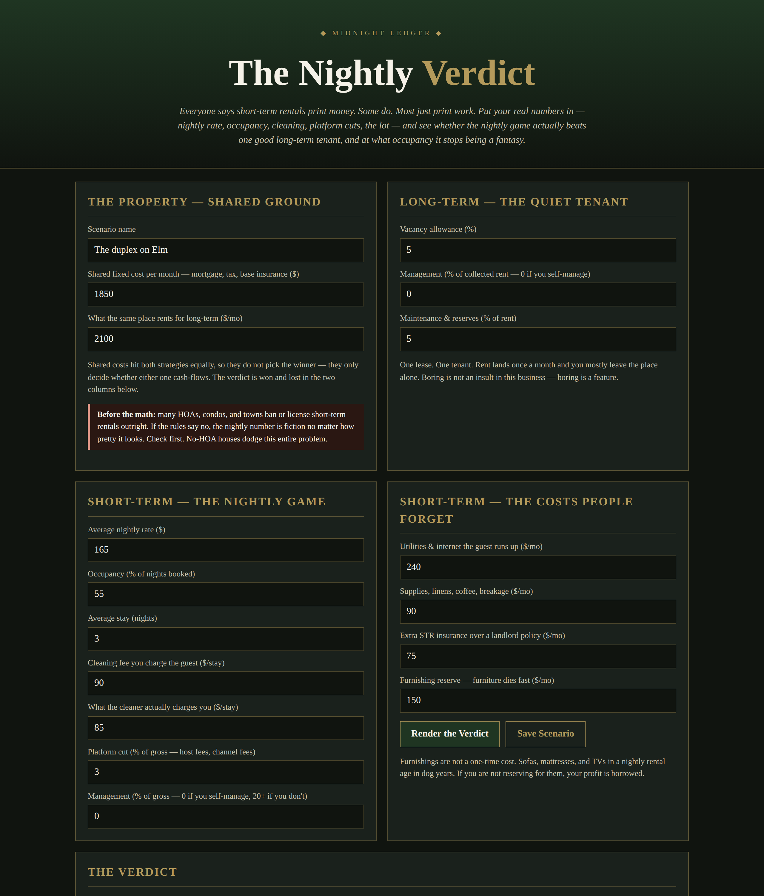

# The Nightly Verdict

**Live:** https://thebullbrew.github.io/nightly-verdict/
**Repo:** https://github.com/thebullbrew/nightly-verdict

## What it does

Everyone says short-term rentals print money. Some do — most just print work. Enter your nightly rate, occupancy, average stay, cleaning fees versus the cleaner's real invoice, platform and management cuts, and the costs hosts forget (guest utilities, supplies, STR insurance uplift, a furnishing reserve), and this tool nets the nightly game against the same house rented long-term with honest vacancy, management, and maintenance charges. It renders a STR WINS / LONG-TERM WINS / DEAD HEAT verdict with the monthly and yearly gap, both nets after shared fixed costs, the breakeven occupancy and breakeven nightly rate where nightly merely ties the tenant, your turnovers per month, and a 25–85% occupancy sensitivity table. Includes saveable scenarios (localStorage) and a copyable summary.

## The method behind it

Compare strategies on net, never gross — screenshots show the best month; this shows the whole year. The nightly side is charged everything it truly consumes, platform and management on the full gross including cleaning fees. Shared costs (mortgage, tax, base insurance) hit both sides equally, so the gap shown is the strategy gap, not the house gap. And a tie goes to the tenant: breakeven means nightly pays nothing extra for the turnovers, messages, reviews, and regulatory risk — demand a real premium before you become a hotel. Lodging/occupancy taxes are not modeled, and many HOAs and towns ban STRs outright; check your rules first.

Educational calculator, not financial advice.

## How to run

Open `docs/index.html` in any browser, or serve `docs/` with any static host. Works offline as a PWA after first load. No backend, no accounts, no data leaves the device.

Dark aesthetic: Variation 1 — Midnight Ledger.
